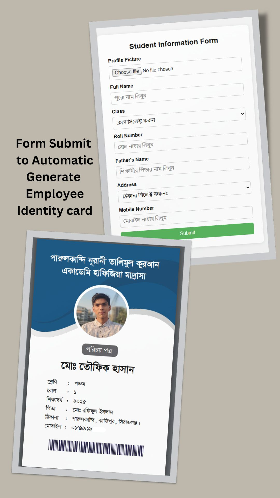

<div align="center">

# 🪪 Automatic ID Card Generator

**স্বয়ংক্রিয় আইডি কার্ড জেনারেটর**

Fill in a short form, and a ready-to-print Bangla student ID card appears a second later.

[](#run-it-locally)
[](#run-it-locally)
[](#how-it-works)
[](LICENSE)

<br />



</div>

---

## Why I built it

**পারুলকান্দি নূরানী তালিমুল কুরআন একাডেমি হাফিজিয়া মাদ্রাসা** needs an ID card for every student.
Designing each one by hand in a graphics app is slow, and one typo means redoing the whole card.

So I turned the card into code. The office types a student's details once, and the app draws the card
itself: the school's header, the photo in a circle, every field in a proper Bangla font, laid out the
same way every time.

## How it works

1. **Fill in the form:** photo, full name, class, roll number, father's name, address and mobile number.
2. **Save:** the details and photo are stored in MySQL, and you go straight to that student's card.
3. **Download:** the card is drawn on an HTML `<canvas>` at the standard ID-card size (2.125 × 3.375 in) and 300 DPI, and saved as a PNG ready to print.

Made a mistake? Open the student again, fix the field and save. The card is redrawn from the updated record.

## Features

- **Bangla-first card design** using the Kalpurush and SutonnyMJ fonts, so names and addresses look right.
- **The madrasa's own classes** in the form, from প্লে and নার্সারী to নাজেরা and beyond.
- **Photo upload,** cropped into a circle on the card.
- **Create and edit:** each student is saved, so a card can be fixed and reprinted later.
- **Flip through students** with previous and next buttons on the card page.
- **One-click PNG download,** print-ready at 300 DPI.
- **No design software needed.** Everything runs in the browser and a small PHP backend.

## How it's built

| | |
|---|---|
| **Frontend** | HTML, CSS, vanilla JavaScript, Canvas API for drawing the card |
| **Backend** | PHP with `mysqli` prepared statements: save, update and fetch a student, plus photo upload |
| **Database** | MySQL, `utf8mb4` so Bangla text is stored correctly |
| **Fonts** | Kalpurush, SutonnyMJ Regular and Bold, loaded before the card is drawn |

```text
index.html            the student form
students.php          a student's card: preview and download
js/
├── handle-form.js    submits the form to save or update a student
├── canvas-card.js    draws the ID card on a canvas and exports it as PNG
├── font-loader.js    makes sure the Bangla fonts are ready first
└── base64-image.js   embedded header and barcode artwork
src/
├── save-form.php     create a student
├── update-form.php   edit a student
├── get_student.php   load a student's details
├── file/             photo upload
└── database/         connection settings
fonts/                Bangla fonts
```

## Run it locally

You'll need PHP and MySQL. [XAMPP](https://www.apachefriends.org/) gives you both, plus Apache.

1. Clone the repo into your web root (for XAMPP, `htdocs`):

   ```bash
   git clone https://github.com/toufikforyou/automatic-employee-card-generator.git
   ```

2. Create the database and the `students` table:

   ```sql
   CREATE DATABASE toufikhasan_madrasha CHARACTER SET utf8mb4 COLLATE utf8mb4_unicode_ci;
   USE toufikhasan_madrasha;

   CREATE TABLE students (
     id        INT AUTO_INCREMENT PRIMARY KEY,
     fullname  VARCHAR(255) NOT NULL,
     stdclass  VARCHAR(100) NOT NULL,
     roll      VARCHAR(50)  NOT NULL,
     father    VARCHAR(255),
     address   TEXT,
     mobile    VARCHAR(20),
     validupto VARCHAR(50),
     profile   VARCHAR(255)
   );
   ```

3. If your MySQL login isn't `root` with no password, update `src/database/config.php`.
4. Open <http://localhost/automatic-employee-card-generator/> and create your first card.

## Ideas for later

- Print a whole class on A4 sheets in one go.
- Swap the fixed barcode strip for a real QR code that links to the student's record.
- Let each school upload its own logo and colours, so the same app works for any institution.

## Author

Built by **MH TOUFIK** · [@toufikforyou](https://github.com/toufikforyou) · [toufikforyou.dev](https://www.toufikforyou.dev)

## License

Released under the [MIT License](LICENSE).
